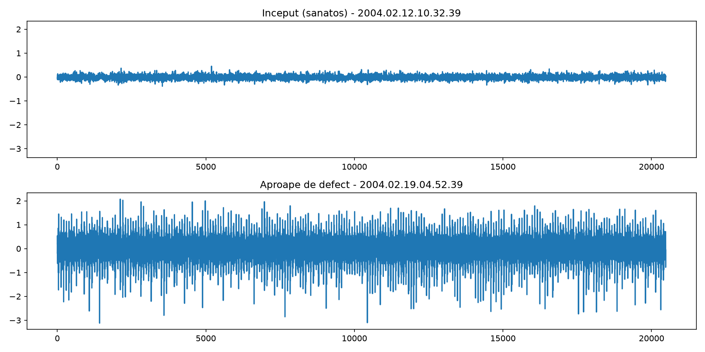
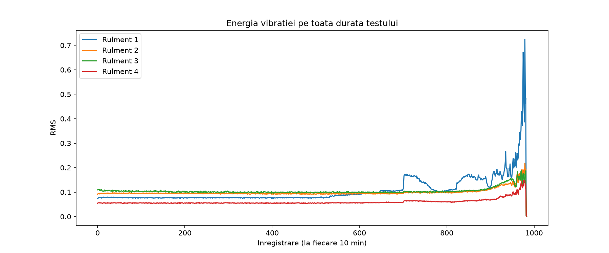
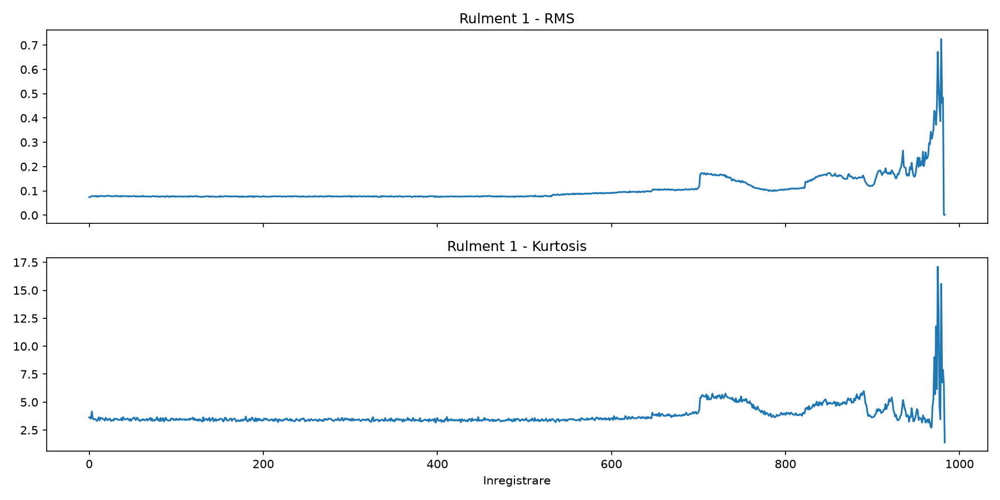
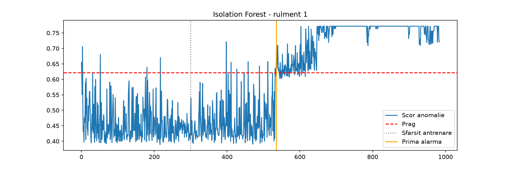

# Bearing Anomaly Detection (NASA IMS)

Unsupervised early fault detection on run-to-failure bearing vibration data.
The model is trained only on healthy data and raises an alarm when the bearing starts to behave differently, with no fault labels needed.

## Why unsupervised

In real industrial settings you have months of normal operation and only a handful of failures, so a classic "healthy vs faulty" classifier is not an option.
Instead, the model learns what *normal* looks like, and anything that deviates from it is flagged as anomalous.

## Data

[NASA IMS Bearing Dataset](https://catalog.data.gov/dataset/ims-bearings), **test 2**:

- 4 bearings on a shared shaft, one accelerometer per bearing
- one 1-second recording (20,480 samples) every 10 minutes
- 984 recordings over ~7 days, ending with an outer race failure on **bearing 1**

**Data quality note:** the last few recordings are near-zero (std ≈ 0.001 vs ≈ 0.45 shortly before).
They were recorded as the test was shutting down and are not representative, so they are excluded from visual comparisons.

## Exploration

Raw signal of bearing 1, healthy vs close to failure (same y-scale):



RMS (vibration energy) of all 4 bearings over the full test. Bearings 2–4 stay flat, bearing 1 degrades toward the end:



## Features

Each recording is summarised into 3 time-domain features:

| Feature | What it captures |
|---|---|
| RMS | overall vibration energy |
| Kurtosis | how impulsive / "spiky" the signal is (≈3 for healthy noise) |
| Peak-to-peak | max − min amplitude |

RMS rises gradually, while kurtosis reacts more abruptly once impacts from the defect appear:



## Model

**Isolation Forest** (scikit-learn), trained on recordings 10–300 (~2 days of healthy operation; the first 10 are excluded as a start-up transient).
No feature scaling is needed, since the model splits on one feature at a time.



## Threshold choice

The model outputs an anomaly score. Where to put the alarm threshold is a real design decision:

| Threshold rule | First alarm | Verdict |
|---|---|---|
| max score on training data | ~47 h before end | correct, but delayed: a single start-up spike inflated the threshold |
| 99th percentile | ~98 h before end | **false alarm**: triggered by an isolated spike in a healthy region |
| 99th percentile + 3 consecutive points (30 min) | **~75 h before end** | correct and early |

The persistence rule ignores isolated spikes and only fires when the score stays above the threshold, which is what a real degradation looks like.

**Limitation:** these settings were chosen while looking at test 2 itself. They still need to be validated, unchanged, on tests 1 and 3.

## How to run

```bash
python3 -m venv .venv
source .venv/bin/activate
pip install numpy matplotlib scipy scikit-learn jupyter
```

Download `IMS.zip` from the link above, extract `2nd_test` into `data/IMS/2nd_test/`, then open `01_exploration.ipynb`.

## Next steps

- Validate the same pipeline on tests 1 and 3
- Frequency-domain features (FFT band energy, envelope spectrum)
- Autoencoder baseline, compared against Isolation Forest
